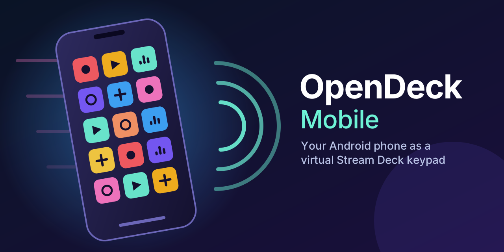

# OpenDeck Mobile

OpenDeck Mobile is an independent Android app that works as a virtual Stream Deck keypad. It
talks to the Stream Deck desktop application over the local network using the "VSD2"
virtual-device protocol. The app shows the key icons the desktop pushes, and it reports key
presses back to the desktop.

It is not affiliated with or endorsed by Elgato or Corsair. "Stream Deck" is a trademark of its
owner and is used here only to describe what the app interoperates with.

## Clean-room process

The project was built with two separate teams:

1. **Specification team.** This team studied the original mobile app's observable behaviour and
   wire formats. It wrote `SPEC.md`, which describes the protocol, the message field numbers,
   the crypto construction, the icon formats and the discovery mechanism. The spec contains no
   code from the original app.
2. **Implementation team (this code).** This team worked only from `SPEC.md`, public standards
   (WebSocket, protobuf wire format, NaCl `crypto_box`, BLAKE2b, LZ4 block format, liblzf
   format, DNS-SD) and public libraries. It never read the original APK, its decompilation or
   its native libraries. Where the spec was ambiguous, the choices made are recorded in
   `IMPLEMENTATION_NOTES.md`.

## Interoperability

The protocol is implemented only to the extent needed for the app to interoperate with
desktop software the user already has:

- Plain WebSocket. Each protobuf message travels in one binary frame.
- A Curve25519 key exchange, then XSalsa20-Poly1305 (`crypto_box`) for every frame after the
  hello messages.
- The user pairs the phone by comparing a 6-character code on both screens.
- Hosts are found with mDNS (`_vstreamdeck2._tcp`), by manual `host[:port]` entry, or from the
  text of a pairing QR link.
- The app does no vendor cloud discovery. It makes no network calls except to the computers
  you connect to on your LAN.

## Project layout

```
android/
  settings.gradle.kts, build.gradle.kts, gradle.properties
  gradle/wrapper/gradle-wrapper.properties   (Gradle 8.10.2)
  core/   pure Kotlin/JVM: protobuf codec, crypto_box, LZ4/LZF, QR/URL parsing,
          keypad math, Session state machine; JUnit tests
  app/    Android app (Compose Material3): NSD discovery, OkHttp WebSocket,
          JSON persistence, screens
```

## Building

You need JDK 17 or newer and the Android SDK (platform 35). The Gradle wrapper (8.10.2) is
checked in, so no local Gradle install is needed:

```
cd android
./gradlew :core:test          # protocol / crypto / codec tests (no Android needed)
./gradlew :app:assembleDebug  # APK in app/build/outputs/apk/debug/
```

You can also open `android/` in Android Studio (Ladybug or newer).

## Using it

1. Start the Stream Deck app on a computer on the same network.
2. Open OpenDeck. Computers it finds appear automatically. You can also tap **Add host** and
   enter `192.168.x.y[:port]`, or paste the pairing QR link.
3. Tap the computer, then tap **Pair**. Accept the request on the computer after checking that
   it shows the same 6-character code as the phone.
4. Choose a virtual device. The first one ("OpenDeck") is created automatically. The keypad
   opens full-screen and keeps the screen on.
